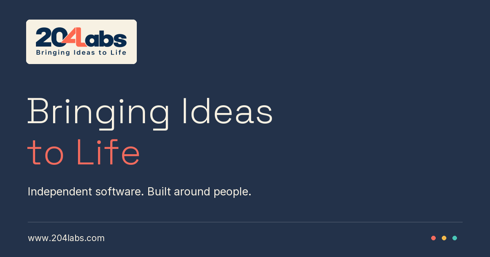

# 204Labs



The official website for [204Labs](https://www.204labs.com), an independent software company based in the United Arab Emirates.

We build software for problems people have learned to live with.

## Products

- [Rewizz](https://rewizzapp.github.io/rewizzapp/): helping teachers get their time back.
- [bAIsect](https://www.baisect.com/): for when building with AI gets you almost there.
- [Sevaya.lk](https://www.sevaya.lk): answers from official sources, with the source beside every one.
- FlatIntel: know more before you sign the lease.

## Site

Static HTML, CSS and JavaScript, hosted on GitHub Pages. The published files are committed, so hosting needs no build.

Product details live in one file, `data/products.json`. After editing it, run:

```
npm run build
npm run test:seo
```

`npm run build` regenerates the homepage product list, every product page, the products index, the company and approach pages, the shared header and footer, the sitemap and `llms.txt`. Do not edit those generated pages by hand.

`npm run test:seo` checks titles, links, navigation and draft wording. It also fails if the ECHO script or styles change without updating `data/echo-lock.json`.

The email sign-up form appears once `data/site.json` has a `signupEndpoint`.

Brand assets belong to 204Labs. Third-party font and icon license notices are included alongside their files.

[Website](https://www.204labs.com) · [Email](mailto:connect@204labs.com)
